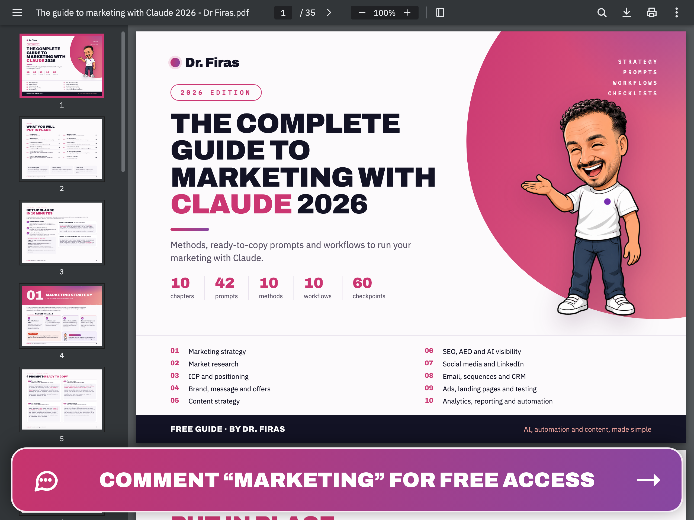

# Claude LinkedIn Guide Skill

**One LinkedIn post a day, without writing a word.** This Claude skill creates a free PDF guide (lead magnet), the post
image and the post text in the “FREE access 👇” format, then publishes or schedules it on LinkedIn with
[Blotato](https://blotato.com/?ref=firas).

Add a Notion database and a scheduled task, and every night Claude picks a topic from your list and schedules the post
for the next morning.

👉 **Create your Blotato account here: [blotato.com/?ref=firas](https://blotato.com/?ref=firas)**

<p align="center">
  
</p>

## The result

This post was **100% created and published by Claude** with this skill: the 35-page guide, the image, the text and the
publishing. (It is the French version of the skill; this repository produces the same thing in English.)

- **10,206 impressions, 256 comments, 128 reactions**
- The post: [see it on LinkedIn](https://lnkd.in/p/e9wrSjkV)
- The PDF this English skill produces: [`docs/example-guide-marketing-claude-2026.pdf`](docs/example-guide-marketing-claude-2026.pdf)

Every post published with this system is on my profile:
**[linkedin.com/in/doctor-firass](https://www.linkedin.com/in/doctor-firass/)**. Follow me to see the new one every morning.

## What the skill does

| Step | What Claude does | What you get |
|---|---|---|
| 1. Outline | 8 to 10 chapters and a keyword (e.g. `MARKETING`) | The guide outline |
| 2. Writing | Two agents write the chapters in parallel, then a script checks everything | The content as JSON |
| 3. PDF | Landscape layout, cover, contents, methods, prompts, workflows, checklists, 30-day plan | The PDF in your local folder |
| 4. Image | The cover inside a PDF viewer, the thumbnails, the COMMENT “KEYWORD” FOR FREE ACCESS → block | `linkedin-post-image.png` |
| 5. Post | “FREE access 👇” text that never asks for comments (LinkedIn reduces the reach of those posts) | `linkedin-post.md` |
| 6. Publishing | Sends the image and the text to Blotato, publishes or schedules | The post is live |

For 10 chapters, each guide has 35 pages, 42 ready-to-copy prompts, 10 methods, 10 workflows and 60 checkpoints. The
cover numbers are computed by the script: they are always true.

<p align="center">
  
</p>

## What you need

| Tool | Why | Link |
|---|---|---|
| **Claude Code** (terminal or Code tab of the Claude Desktop app) | The skill runs Python scripts on your computer | [claude.com/claude-code](https://claude.com/claude-code) |
| **Blotato** | Publishes and schedules the post on LinkedIn | [blotato.com/?ref=firas](https://blotato.com/?ref=firas) |
| **Google Chrome** (or Chromium, Edge) | Turns the layout into a PDF and an image | [google.com/chrome](https://www.google.com/chrome/) |
| **Python 3** | The skill's scripts | [python.org](https://www.python.org/downloads/) |
| **Poppler** (`pdftoppm`, `pdfinfo`) | The page thumbnails in the image | see below |
| **Notion** (optional) | The topic queue for auto mode | [notion.com](https://www.notion.com/) |

Install Poppler:

```bash
brew install poppler
```

On Linux: `sudo apt install poppler-utils`. On Windows: download
[poppler-windows](https://github.com/oschwartz10612/poppler-windows/releases) and add its `bin` folder to your PATH.

## Installation

**1. Get the skill and copy it into your Claude skills**

```bash
git clone https://github.com/DrFIRASS/claude-linkedin-guide-skill-en.git
```

```bash
cp -R claude-linkedin-guide-skill-en/linkedin-guide-post ~/.claude/skills/
```

**2. Connect Blotato to Claude**

Create your account on [blotato.com](https://blotato.com/?ref=firas) and connect your LinkedIn account in the Blotato
settings. Then, in Claude Code:

```bash
claude mcp add --transport http Blotato https://mcp.blotato.com/mcp
```

Run `/mcp` in Claude Code, pick Blotato then “Authenticate”, and restart Claude Code.

In the Claude Desktop app, you can also add it as a custom connector with the same URL `https://mcp.blotato.com/mcp`
(official guide: [help.blotato.com/api/mcp/setup](https://help.blotato.com/api/mcp/setup)).

**3. (Optional) Connect Notion** for auto mode

```bash
claude mcp add --transport http notion https://mcp.notion.com/mcp
```

**4. Run your first guide**

In Claude Code, type for example:

```text
Make me a PDF guide + the LinkedIn post about “automation with n8n for beginners”
```

On the first run, Claude asks a few questions (your name, your signature, your folder, your mascot, your time zone) and
finds your LinkedIn account in Blotato. It saves everything in `~/.claude/skills/linkedin-guide-post/config.json`. After
that, it asks nothing.

Before publishing, Claude shows you the text and the image and waits for your “go”. If your request already says
“publish it” or “schedule it tomorrow at 8 am”, it does it right away.

## The automatic system: one post a day with Notion

This is what I use every day. You add topics in Notion, Claude does the rest every night.

### 1. Duplicate the Notion template

👉 **[Duplicate the “LinkedIn guide queue” database](https://www.notion.so/41f3d6550fd9811085ded69fcf9f1e59)**
(“Duplicate” button at the top right of the page)

The database columns:

| Column | Type | Filled by | Role |
|---|---|---|---|
| `Topic` | Title | You | The guide topic, e.g. “The guide to automation with n8n” |
| `Source` | URL | You (optional) | A LinkedIn post or an article that inspires you |
| `Instructions` | Text | You (optional) | Audience, number of chapters, angle, preferred keyword |
| `Status` | Select | You, then Claude | `To do` → `In progress` → `Done` or `Error` |
| `Keyword` | Text | Claude | The chosen keyword, e.g. `N8N` |
| `PDF file` | Text | Claude | The path of the PDF on your computer |
| `Post link` | URL | Claude | The LinkedIn link, added after publishing |
| `Publish date` | Date and time | Claude | When the post is scheduled |
| `Blotato ID` | Text | Claude | The id of the scheduled post in Blotato |
| `Error message` | Text | Claude | The cause, if a topic could not be processed |
| `Added on` | Created time | Notion | Used to process topics in order |

To add a topic: a new row, a `Topic`, `Status` set to `To do`. That's it.

### 2. Give your copy to Claude

In Claude Code:

```text
Set up auto mode for the linkedin-guide-post skill with my Notion database: <link to your copy>
```

Claude saves the database, your publish time (8 am by default) and your time zone in `config.json`.

### 3. Create the scheduled tasks

In the Claude Desktop app (Code tab, “Scheduled tasks”) or with `/schedule` in Claude Code, create:

| Task | When | Text to copy |
|---|---|---|
| Nightly guide + LinkedIn post | Every day at 12:05 am | [`scheduled-tasks/nightly-linkedin-guide.md`](scheduled-tasks/nightly-linkedin-guide.md) |
| LinkedIn post links (optional) | Every day at 8:30 am | [`scheduled-tasks/linkedin-post-links.md`](scheduled-tasks/linkedin-post-links.md) |

Every night, Claude takes the oldest `To do` topic, creates the guide, the image and the post, schedules the post for
8 am and updates the Notion row. The computer must be on and the Claude app open at the time of the task.

## Sending the guide to people who comment

The PDF is saved in your local folder (`~/Documents/linkedin-guides/<keyword>/` by default). When someone comments the
keyword, send them the PDF as an attachment in a LinkedIn message, or a link (Google Drive, Notion, Dropbox, your
website). Claude gives you the ready-made message at the end of each guide.

## Customize

| What | Where |
|---|---|
| Your name, signature, website | `config.json` (created on first run) |
| Your mascot | Replace the 3 PNGs in `linkedin-guide-post/assets/mascot/` (`cover.png`, `tip.png`, `end.png`, transparent background) and set `"mascot": true` in `config.json` |
| The colors | The variables at the top of `linkedin-guide-post/scripts/style.css` |
| The post format | `linkedin-guide-post/references/linkedin-post.md` |
| The tone and writing rules | `linkedin-guide-post/references/content-schema.md` |

Without a mascot, the guide stays complete: the cover and the end page simply have no character.

## Repository contents

```text
claude-linkedin-guide-skill-en/
├── README.md
├── LICENSE
├── docs/                          Example: post screenshot, generated image, full PDF
├── scheduled-tasks/               The text of the 2 scheduled tasks
└── linkedin-guide-post/           The skill, to copy into ~/.claude/skills/
    ├── SKILL.md                   The instructions Claude follows
    ├── config.example.json        The configuration template
    ├── references/                Setup, content, post, Blotato publishing, auto mode
    ├── scripts/                   check_content.py, build_guide.py, build_image.py, common.py, style.css
    └── assets/
        ├── example-marketing/     The full MARKETING guide (JSON content + post)
        └── mascot/                The example mascot (replace it with yours)
```

## FAQ

**Does it work on claude.ai in the browser?** No. The skill runs Chrome and Python on your computer: you need Claude
Code (in the terminal or in the Code tab of the Claude Desktop app).

**Does it work on Windows?** Yes: the scripts find Chrome or Edge on their own. If Chrome is installed somewhere else, put
its path in the `CHROME_PATH` variable.

**Does Claude make up numbers?** No. The skill's rules ban any made-up statistic or result, and a script checks the
content before building the PDF. Still, read each guide before you share it.

**Does the post ask for comments?** Only in the image. The text never says “comment”: LinkedIn reduces the reach of posts
that ask for it.

**Is there a French version?** Yes: [github.com/DrFIRASS/claude-linkedin-guide-skill](https://github.com/DrFIRASS/claude-linkedin-guide-skill).

## Author

**Dr. Firas**, AI, automation and content, made simple.

- LinkedIn: [linkedin.com/in/doctor-firass](https://www.linkedin.com/in/doctor-firass/)
- Guides: [getguide.io](https://getguide.io/guides)
- Blotato (affiliate link): [blotato.com/?ref=firas](https://blotato.com/?ref=firas)

The Blotato link is an affiliate link: if you subscribe, I earn a commission, at no extra cost to you.

## License

Code under the [MIT](LICENSE) license. The mascot in `assets/mascot/` belongs to Dr. Firas and is not covered by the
license: it is only there for the example.
